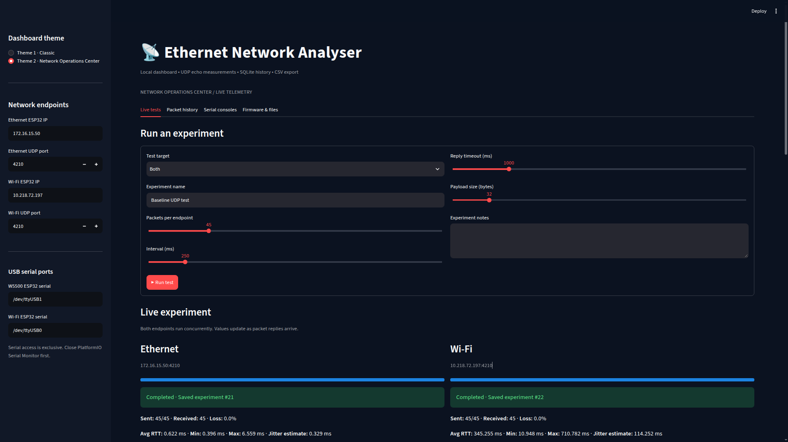
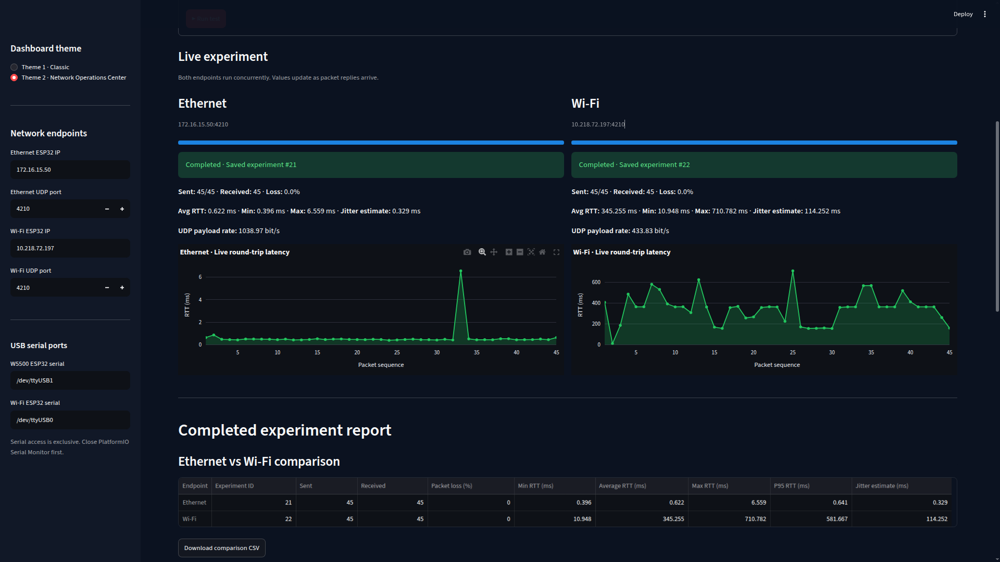
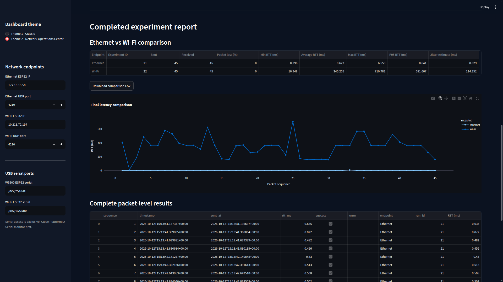
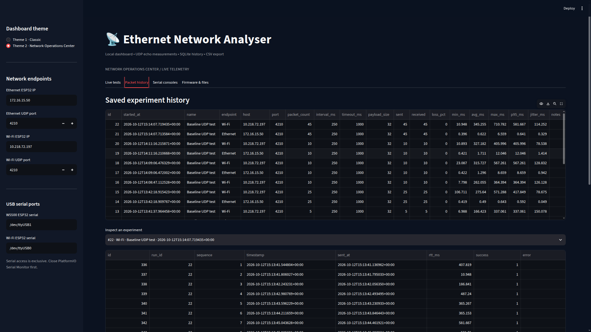
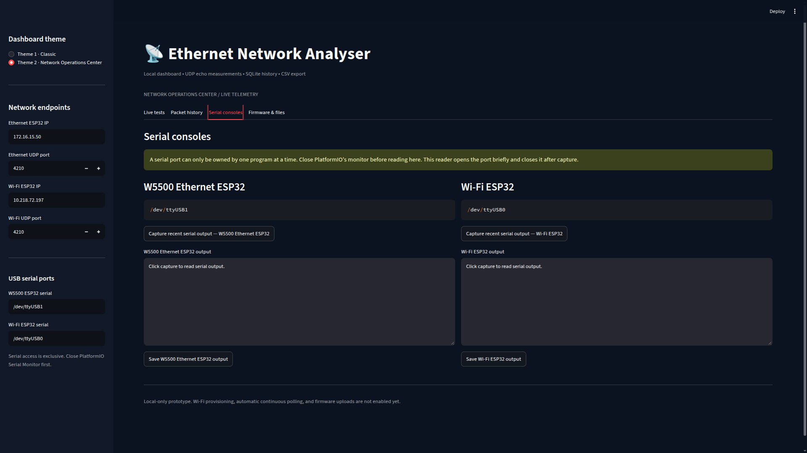
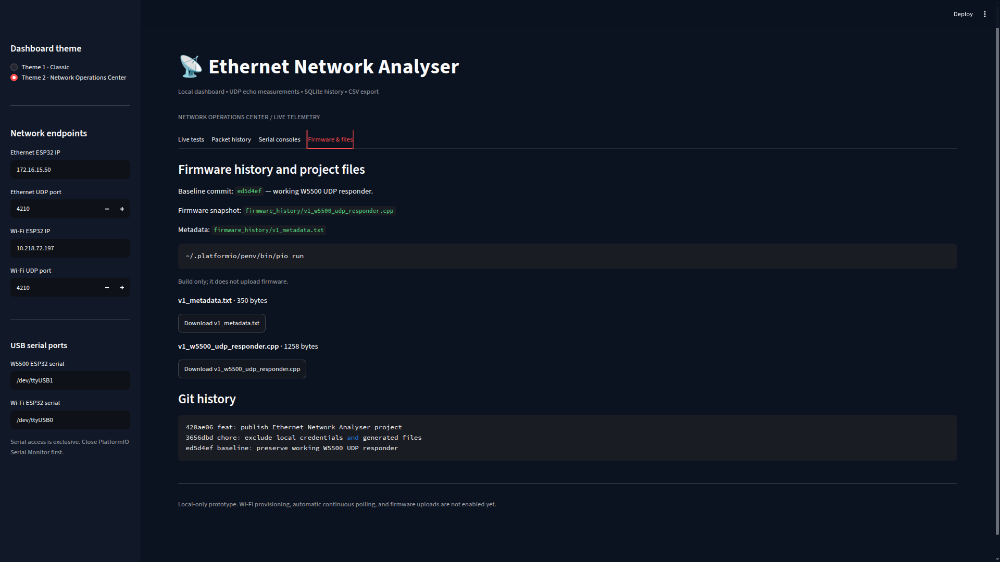
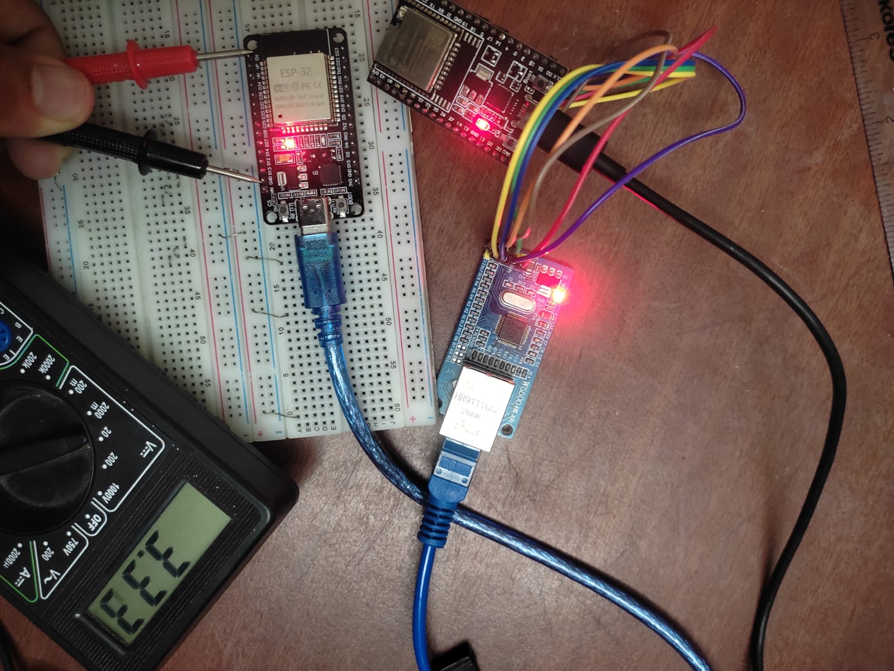

# Ethernet Network Analyser

A hardware-software network monitoring prototype using an ESP32, W5500 Ethernet module, a second Wi-Fi ESP32, and a Python Streamlit dashboard.

Measure UDP echo round-trip time, packet loss, jitter estimates, and payload throughput. Compare Ethernet and Wi-Fi experiments, inspect packet-level results, and save measurements for later analysis.

## Features

- ESP32 + W5500 wired Ethernet UDP echo responder.
- Second ESP32 running a Wi-Fi UDP echo responder.
- Python/Streamlit monitoring dashboard.
- Ethernet-only, Wi-Fi-only, and concurrent comparison tests.
- Live packet counters and RTT charts.
- RTT statistics: minimum, average, maximum and P95.
- Packet-loss percentage and jitter estimate.
- SQLite experiment history and CSV exports.
- Serial console access and firmware/project inspection.
- Selectable dashboard themes.

## System architecture

```text
                 Python / Streamlit Dashboard
                    Laptop / Ubuntu Linux
                    /                  \
         Ethernet interface          Wi-Fi interface
          172.16.15.42                 10.218.72.180
                |                            |
             W5500 module                 Wi-Fi network
                |                            |
             ESP32 #1                     ESP32 #2
          Ethernet UDP echo             Wi-Fi UDP echo
                |                            |
                +------ UDP measurements ----+
```

The IP addresses above are example values from the development setup. Change them to match your own network.

## Hardware

| Component | Purpose |
|---|---|
| ESP32 DevKit V1 | Ethernet-side controller |
| W5500 Ethernet module | SPI-based wired Ethernet interface |
| Second ESP32 | Wi-Fi-side UDP responder |
| USB data cables | Programming, power and serial debugging |
| Breadboard and jumper wires | Prototyping connections |
| Laptop running Ubuntu | Dashboard, tests, storage and analysis |

## W5500 wiring

| W5500 signal | ESP32 GPIO |
|---|---:|
| SCLK / SCK | GPIO 14 |
| MISO | GPIO 12 |
| MOSI | GPIO 13 |
| CS / SCS | GPIO 15 |
| RST | GPIO 5 |
| GND | GND |
| VCC | 3.3 V, as used in this prototype |

Confirm the pinout and voltage requirements of your exact module before connecting it. Never assume all breakout boards use the same power arrangement.

Connect the W5500 Ethernet jack to the laptop's Ethernet interface. Keep the second ESP32 connected to Wi-Fi.

## Software requirements

- Ubuntu Linux (developed on Ubuntu 24.04 LTS)
- Python 3.12 or compatible Python version supported by the dependencies
- PlatformIO Core
- VS Code with PlatformIO, or PlatformIO CLI
- Arduino framework for ESP32
- Git
- Two ESP32 boards and a W5500 module

## 1. Clone the project

```bash
git clone https://github.com/sonuraj-dev/ethernet-network-analyser.git
cd ethernet-network-analyser
```

If you fork this project, use your fork's URL instead.

## 2. Set up the Python dashboard

```bash
python3 -m venv .venv
source .venv/bin/activate
python -m pip install --upgrade pip
pip install -r requirements-dashboard.txt
```

Start the dashboard:

```bash
.venv/bin/streamlit run dashboard/app.py
```

Open the local URL printed by Streamlit, normally `http://localhost:8501`.

## 3. Build and flash the Ethernet firmware

Install PlatformIO and connect the W5500 ESP32 over USB. Check the serial device name before uploading.

```bash
~/.platformio/penv/bin/pio run
~/.platformio/penv/bin/pio run -t upload --upload-port /dev/ttyUSB1
~/.platformio/penv/bin/pio device monitor --port /dev/ttyUSB1 --baud 115200
```

The serial device may differ on your computer. Close the serial monitor before starting another upload or using the dashboard serial console.

## 4. Configure the Wi-Fi responder

The second ESP32 runs a UDP echo responder on port 4210. Configure the Wi-Fi SSID and password locally in its firmware before uploading.

Do not commit real credentials. Use placeholders in examples and keep local secrets out of Git.

The laptop must be able to reach both ESP32 endpoints. Confirm the configured IP addresses and UDP port in the dashboard sidebar.

## 5. Run an experiment

1. Connect and power both ESP32 boards.
2. Confirm the Ethernet link and Wi-Fi connection.
3. Start the Streamlit dashboard.
4. Select Ethernet, Wi-Fi or Both.
5. Configure packet count, interval, timeout, payload size and experiment notes.
6. Start the test.
7. Inspect live measurements and the final report.
8. Review saved experiments and export CSV data.

## Metrics and interpretation

- **RTT:** elapsed time from sending a UDP request until receiving its echo reply.
- **Packet loss:** percentage of sent requests without a valid reply within the configured timeout.
- **Jitter estimate:** mean absolute difference between consecutive successful RTT samples in the current implementation.
- **P95 RTT:** 95th-percentile-style statistic calculated from successful RTT samples.
- **UDP payload rate:** useful payload bits delivered divided by elapsed time, when calculated by the test engine.

These measurements include host scheduling, the operating system, network conditions and responder behavior. They are not a pure measurement of cable or PHY performance.

One-way latency, TCP retransmissions, physical frame errors, collisions, and TTL expiry require additional instrumentation and are not established by the UDP echo test alone.

## Data and privacy

Experiment history is stored locally in SQLite. CSV exports may contain device addresses and measurement timestamps. Review them before publishing.

Never commit Wi-Fi passwords, tokens, personal network details, virtual environments, generated data or private logs.

## Troubleshooting

- **No UDP reply:** check device power, IP configuration, port 4210, network reachability and firmware.
- **Wrong serial port:** inspect available devices using `ls /dev/ttyUSB* /dev/ttyACM*`.
- **Permission denied:** ensure your user has serial-device permissions and re-login after changing group membership.
- **Streamlit port already in use:** stop the previous dashboard process or select another local port.
- **Unexpected latency:** repeat measurements under consistent conditions and compare individual endpoint tests with concurrent tests.
- **Missing Python modules:** activate the virtual environment and reinstall `requirements-dashboard.txt`.

## Project status

This is a prototype intended for education, experimentation and portfolio demonstration. Advanced physical-layer and TCP metrics require additional implementation and validation.

## Contributing

Issues, bug reports, documentation improvements and tested feature contributions are welcome. Please do not publish credentials, private logs or identifiable network information.

## License

This project is intended to be released under the MIT License. See `LICENSE`.

## Screenshots

### Live Dashboard


### Live Latency Charts


### Ethernet vs Wi-Fi Comparison


### Packet History


### Serial Consoles


### Firmware and Git History


### Hardware Setup

